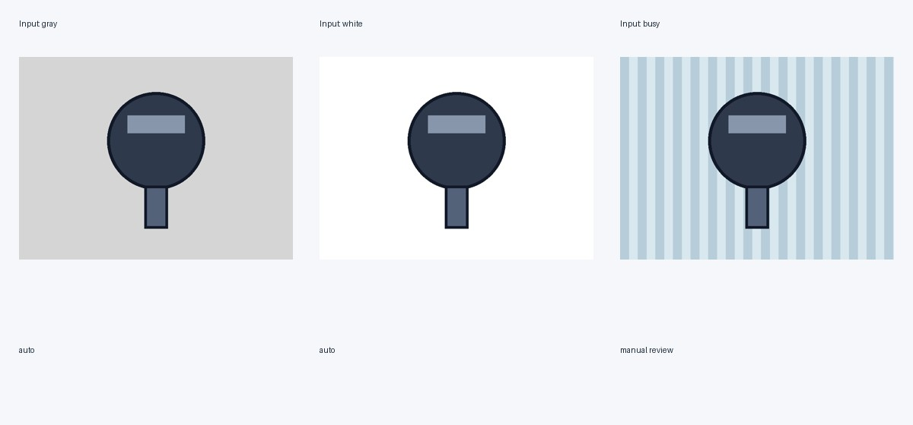

# Подготовка товарных фотографий

Небольшой демонстрационный конвейер: читает CSV со ссылками на фото, выделяет товар на **почти однотонном белом или сером фоне**, создаёт квадратный JPG на белом фоне и дописывает второй столбец со ссылкой на готовое изображение. Кадры со сложным фоном отправляет на ручную проверку. Исходный CSV и исходные изображения не изменяются.



## Быстрый запуск

Нужен Python 3.10 или новее.

```powershell
python -m pip install -r requirements.txt
python make_demo.py
python photo_pipeline.py demo/catalog.csv --output output
```

Откройте `output/result.csv`. В нём остаются исходные колонки, а также появляются `processed_url`, `status` (`ready`, `review`, `error`) и `note`. Для строк `ready` в папке `output` создаётся JPG. Демонстрационные изображения сгенерированы специально для этого репозитория; в нём нет чужих фотографий и доступов.

Для своей таблицы укажите CSV с обязательной колонкой `image_url`: это может быть HTTP(S)-ссылка или путь к файлу относительно CSV. Остальные колонки сохраняются. Например:

```csv
sku,image_url
ABC-123,https://example.org/photo.jpg
```

## FTP

Загрузка выключена по умолчанию. Для неё задайте логин и пароль переменными окружения `PHOTO_FTP_USER` и `PHOTO_FTP_PASSWORD`, затем запустите:

```powershell
python photo_pipeline.py catalog.csv --output output --upload --ftp-host ftp.example.org --ftp-dir /catalog --public-base-url https://example.org/catalog
```

В таком режиме `processed_url` содержит публичный адрес JPG. Вводить настоящие доступы в исходный код или Git не нужно. FTP передаёт пароль без шифрования; для рабочего использования лучше добавить FTPS/SFTP после согласования возможностей сервера.

## Пределы демонстрации

Простая проверка однородности краёв позволяет автоматически отобрать часть фото с белым или серым фоном. Она не гарантирует точный контур для теней, полупрозрачных деталей, близкого к фону цвета товара и сложного окружения. Такие фотографии должны проходить ручную проверку или обработку моделью сегментации. Точность, пороги и итоговый формат нужно проверить на реальной выборке до пакетной загрузки.
